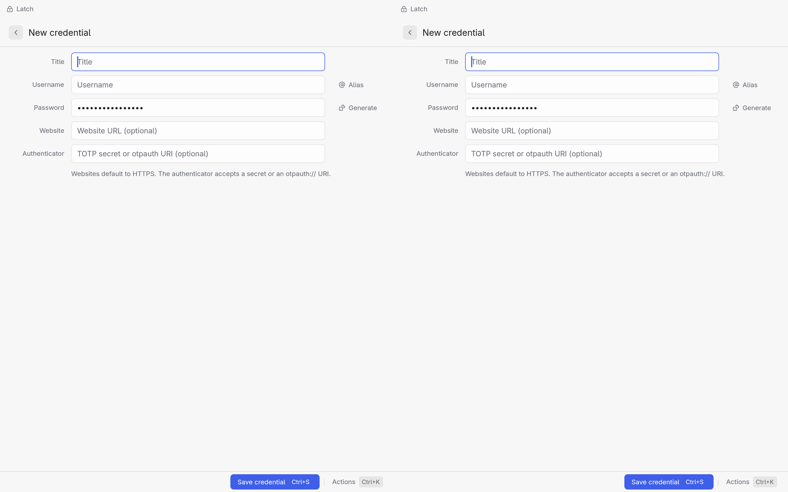
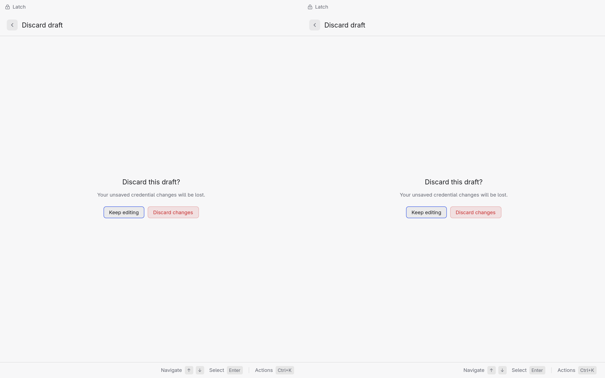

# Session and draft ownership verification

The cleanup makes active Session data, desktop operations, and Credential draft identity explicit. It fixes four state bugs:

- An expired Workspace could leave Credential form fields displayed until the next input event.
- A failed update installation could enable Access before a pending lock completed.
- An older queued lock could acquire the mutex after a newer lock and Access, then close the new Session.
- Replacing an alias-generated username could retain the previous alias provider association.

The key and last-activity time now belong to one private Session. Desktop operations use `Idle`, `Working`, `Locking`, and `Installing`; the existing epoch guards remain. A draft owns its Credential ID and a zeroizing copy of the alias username used to validate its provider association. Form cleanup is shared by save, discard, navigation and lock.

## Scope decisions

The existing Session deadline and generation checks, Lockout, ClipboardGuard ownership check, transactional rollback, and atomic Vault replacement remain. They already have small, guarded models. Search, selection, focus, appearance, provider configuration, favicon loading, platform resource lifetimes, and IME were inspected during the inventory; no further state framework or dependencies were introduced.

Vault serialization, encryption algorithms, KDFs, device-key identifiers, the 30-minute inactivity duration, and network endpoints are unchanged. This change encapsulates key handling and fixes UI synchronization with Session expiry.

## Regression proof

The desktop tests cover the four bugs above:

- `tick_clears_ui_secrets_when_the_workspace_was_already_locked`
- `failed_install_stays_busy_until_the_newest_lock_lands`
- `a_stale_lock_task_cannot_lock_a_later_session`
- `alias_provenance_is_saved_only_while_the_username_matches`

Each failed with its old behavior restored and passed after the fix. A core test also checks that refreshing a locked Workspace cannot create partial Session state. Existing expiry, cancellation, rotation, rollback, and historical Vault compatibility tests pass.

The repository checklist passes: formatting, desktop all-target compile check, strict Clippy for both crates, 89 core tests, and 25 desktop tests. Two desktop tests remain ignored by default, including the script driver exercised separately. The core legacy-OAuth feature passes 105 tests.

## Real-view verification

The `verify-latch` doctor passes. Six sandbox scripts exercise Provision and Access, wrong password and Lockout, Credential creation/edit/validation/deletion, search and copy, Actions and root commands, generator use from an existing form and from Details, discard guards, and persistence across lock/unlock. The search/copy recipe also passes at 520x360. Websites use `.invalid`, and Vault assertions check that saved passwords are not present in plaintext.

The generator recipe includes the Details-to-new-Credential regression journey. No user path or layout was redesigned.

The comparisons below show `main` at `dc4e16c` on the left and the cleanup on the right, at 720x900. The generated draft, existing draft, and discard guard each have **0 changed pixels**. These images prove preserved rendering only. The regression tests prove the state and completion-order fixes.

Local transcripts, scripts, screenshots, and sandbox Vaults are under `target/verify/`. The final comparison is `target/verify/draft-identity/20261115T094524Z/`; checklist logs are in `target/verify/validation/`. Sandbox Vaults are ignored and are not committed.

## Limits

The harness renders the real Command Palette in light appearance and uses a test clipboard. It does not verify dark appearance, window controls, global hotkeys, tray/show-hide behavior, OS clipboard ownership/expiry, device-key prompts, IME, or live network providers. Installation failure is tested at the failure callback and lock boundary; no installer was downloaded or executed. Screenshots cannot establish the absence of races.
